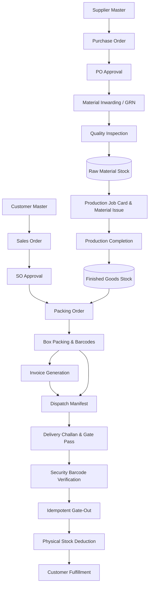

# Manufacturing ERP 2.0 — Workflow & RBAC Audit Specification

## 1. Complete Business Workflow Architecture

The ERP operates on two distinct, coupled transactional chains:
- **Procurement & Inwarding (Supply-Side)**: Supplier Master → Purchase Order (PO) → Approval → Inwarding / GRN → Quality Inspection → Inventory Posting (Stores).
- **Manufacturing & Customer Fulfillment (Demand-Side)**: Customer Master → Sales Order (SO) → Approval → Production Planning (BOM & Job Cards) → Material Issue → Production Execution → Quality & FG Receipt → Packing Order & Box Packing → Barcode Labeling → Invoice Generation → Dispatch Manifest → Delivery Challan & Gate Pass → Security Barcode Verification → Idempotent Gate-Out & Canonical Stock Deduction → Customer Delivery.

---

## 2. Role Descriptions & Separation of Duties

| Role | Primary Responsibilities | Strict Boundaries |
|---|---|---|
| **Administrator** | Full system administration, role configuration, master definitions, audit oversight, emergency overrides. | All actions logged in `AuditLog`. |
| **Management** | Executive KPI visibility, PO approvals, SO approvals, invoice approvals, financial reports. | No operational gate-out without security verification. |
| **Purchase User** | Supplier master management, creation and editing of draft POs, supplier documents. | Cannot approve own POs; cannot modify taxes or stores masters. |
| **Stores User** | Receiving supplier shipments, creating GRNs, managing inventory ledger, issuing materials to production, stock transfers. | Cannot manipulate stock without reason; cannot approve invoices. |
| **Production User** | Bill of Materials (BOM), routings, production plans, releasing and tracking job cards, material issue requests. | Cannot exceed planned production caps; cannot manage system users. |
| **Quality User** | Inspecting inwarded GRNs, recording accepted vs rejected quantities with mandatory reasons, verifying production output. | Only accepted quantities enter usable stock ledger. |
| **Packing User** | Packing finished goods into boxes, scanning barcodes, printing barcode labels, sealing boxes against Packing Orders. | Cannot pack more than available finished goods stock; cannot reopen dispatched boxes. |
| **Billing User** | Customer invoicing, calculating GST/taxes, commercial verification, invoice submission and approval. | Cannot deduct inventory on invoice payment; inventory is only deducted at Gate-Out. |
| **Dispatch User** | Shipment manifests, assigning transporters and vehicles, generating Delivery Challans and Gate Passes, scanning boxes. | Cannot gate-out with unverified boxes or unapproved invoices. |

---

## 3. Fine-Grained Permission Matrix

| Permission Code | Module | Description | Granted Roles |
|---|---|---|---|
| `po.view` | Purchase | View purchase orders | Admin, Mgmt, Purchase, Stores, Quality |
| `po.create` | Purchase | Create draft POs | Admin, Purchase |
| `po.edit` | Purchase | Edit draft POs | Admin, Purchase |
| `po.approve` | Purchase | Approve or reject POs | Admin, Mgmt |
| `grn.view` | Inwarding | View GRNs | Admin, Mgmt, Purchase, Stores, Quality |
| `grn.create` | Inwarding | Create GRN and inward materials | Admin, Stores |
| `grn.verify` | Inwarding | Quality inspection sign-off | Admin, Quality |
| `inventory.view` | Inventory | View stock levels and movements | Admin, Mgmt, Purchase, Stores, Production |
| `inventory.manage`| Inventory | Stock transfers | Admin, Stores |
| `inventory.adjust`| Inventory | Stock adjustments with reason | Admin, Stores |
| `inventory.issue` | Inventory | Issue material to production | Admin, Stores, Production |
| `inventory.return`| Inventory | Return material from production | Admin, Stores, Production |
| `production.view` | Production | View BOM, plans, job cards | Admin, Mgmt, Production, Quality |
| `production.manage`| Production| BOM, plans, complete job cards | Admin, Production |
| `packing.view` | Packing | View boxes and packing orders | Admin, Mgmt, Packing, Billing, Dispatch |
| `packing.manage` | Packing | Create boxes, add items | Admin, Packing |
| `packing.close` | Packing | Close and seal boxes | Admin, Packing |
| `barcode.scan` | Barcode | Scan barcodes for packing/dispatch | Admin, Stores, Production, Quality, Packing, Dispatch |
| `barcode.print` | Barcode | Print barcode/box labels | Admin, Packing |
| `billing.view` | Billing | View invoices & sales orders | Admin, Mgmt, Billing |
| `billing.manage` | Billing | Create and edit invoices & SOs | Admin, Billing |
| `billing.approve`| Billing | Approve invoices & SOs | Admin, Mgmt, Billing |
| `dispatch.view` | Dispatch | View dispatches & gate passes | Admin, Mgmt, Dispatch |
| `dispatch.manage`| Dispatch | Create dispatches & manifests | Admin, Dispatch |
| `dispatch.gate_out`| Dispatch | Authorize physical gate-out | Admin, Dispatch, Mgmt |
| `documents.view` | Documents | View documents and drawings | Admin, Mgmt, Purchase, Stores, Production |
| `documents.upload`| Documents| Upload documents | Admin, Mgmt, Purchase, Stores, Production |
| `documents.delete`| Documents| Delete documents | Admin |
| `users.view` | Users | View system users and roles | Admin, Mgmt |
| `users.create` | Users | Create system users | Admin |
| `users.edit` | Users | Edit system users | Admin |
| `roles.manage` | Roles | Manage roles and permissions | Admin |
| `reports.view` | Reports | View reports | Admin, Mgmt, Purchase, Billing |
| `reports.export` | Reports | Export reports to Excel/PDF | Admin, Mgmt |
| `audit.view` | Audit | View audit logs | Admin, Mgmt |

---

## 4. Status Transition Machines

### Purchase Order (PO)
`DRAFT` → `SUBMITTED` → `APPROVED` / `REJECTED` → `PARTIAL` → `COMPLETED` / `CANCELLED`

### Goods Receipt Note (GRN)
`DRAFT` → `VERIFIED` / `PARTIALLY_ACCEPTED` / `REJECTED`

### Sales Order (SO)
`DRAFT` → `SUBMITTED` → `APPROVED` → `PARTIALLY_FULFILLED` → `FULFILLED` / `CANCELLED`

### Packing Order (PKO)
`DRAFT` → `RELEASED` → `IN_PROGRESS` → `COMPLETED` / `CANCELLED`

### Box
`OPEN` → `SEALED` → `DISPATCHED`

### Invoice
`DRAFT` → `APPROVED` → `PAID` / `CANCELLED`

### Dispatch & Gate Pass
`PREPARED` → `VERIFIED` → `GATE_OUT` / `DISPATCHED`

---

## 5. Barcode & Inventory Traceability

1. **Barcode Uniqueness**: Every barcode is uniquely constrained in PostgreSQL (`Barcode.code`).
2. **Barcode Lifecycle**: Statuses are `ACTIVE`, `USED`, `RETIRED`. Scanning inactive barcodes is blocked.
3. **Scan History**: Every scan action (`BOX_PACK`, `DISPATCH_VERIFY`, `AUDIT`) writes to `BarcodeScanHistory` with user, device, timestamp, action, and result status.
4. **Canonical Inventory Deduction**:
   - Invoice creation/payment **never** mutates physical inventory.
   - Finished goods stock is checked and validated during box packing.
   - Physical inventory deduction occurs **exclusively at Gate-Out**.
   - Gate-out resolves stock from the `FINISHED_GOODS` store first.
   - Gate-out is idempotent: calling gate-out repeatedly rejects duplicate executions cleanly without double deducting stock.
