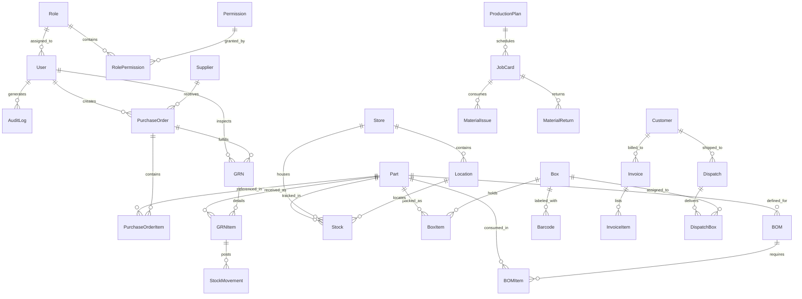

# Database Design: Manufacturing ERP 2.0

## 1. Schema Overview
The database uses normalized relational structures managed via Prisma ORM for PostgreSQL. All primary business records enforce foreign key constraints, indexes on query predicates, timestamps, and audit references.

### Entity Relationship Summary

## 2. Core Entities

### Authentication & RBAC
- **`User`**: `id`, `email`, `passwordHash`, `firstName`, `lastName`, `phone`, `roleId`, `isActive`, `refreshToken`, `createdAt`, `updatedAt`
- **`Role`**: `id`, `name`, `description`, `isSystem`, `createdAt`
- **`Permission`**: `id`, `code` (e.g. `po.approve`), `module`, `description`
- **`RolePermission`**: `roleId`, `permissionId`

### Master Data
- **`Customer`**: `id`, `code`, `name`, `email`, `phone`, `gstin`, `billingAddress`, `shippingAddress`, `isActive`
- **`Supplier`**: `id`, `code`, `name`, `email`, `phone`, `gstin`, `address`, `paymentTerms`, `isActive`
- **`Part`**: `id`, `code`, `name`, `description`, `partType` (RAW_MATERIAL, WORK_IN_PROGRESS, FINISHED_GOOD), `unitId`, `minStockLevel`, `hsnCode`, `standardCost`, `barcodeValue`, `isActive`
- **`Unit`**: `id`, `name`, `symbol` (e.g., PCS, KG, MTR)
- **`Store`**: `id`, `code`, `name`, `type` (RAW_MATERIALS, FINISHED_GOODS, SCRAP, GENERAL), `isActive`
- **`Location`**: `id`, `storeId`, `code`, `name`, `rack`, `bin`
- **`Tax`**: `id`, `name`, `rate` (e.g. 18.00), `type` (GST, IGST, VAT), `isActive`
- **`Transporter`**: `id`, `code`, `name`, `contactPerson`, `phone`, `vehicleNumbers`, `isActive`

### Purchase & Inwarding (GRN)
- **`PurchaseOrder`**: `id`, `poNumber` (Unique), `supplierId`, `status` (DRAFT, SUBMITTED, APPROVED, REJECTED, PARTIALLY_RECEIVED, COMPLETED, CANCELLED), `orderDate`, `deliveryDate`, `totalAmount`, `taxAmount`, `grandTotal`, `approvedById`, `notes`
- **`PurchaseOrderItem`**: `id`, `purchaseOrderId`, `partId`, `orderedQty`, `receivedQty`, `unitPrice`, `taxRate`, `lineTotal`
- **`GRN`**: `id`, `grnNumber` (Unique), `purchaseOrderId`, `supplierInvoiceNo`, `invoiceDate`, `receivedDate`, `status` (DRAFT, VERIFIED, REJECTED), `receivedById`, `remarks`
- **`GRNItem`**: `id`, `grnId`, `partId`, `poItemId`, `receivedQty`, `acceptedQty`, `rejectedQty`, `damagedQty`, `storeId`, `locationId`, `batchNumber`, `rejectionReason`

### Inventory & Stock Movement Ledger
- **`Stock`**: `id`, `partId`, `storeId`, `locationId`, `quantityOnHand`, `reservedQty`, `batchNumber`, `updatedAt`
- **`StockMovement`**: `id`, `partId`, `storeId`, `locationId`, `movementType` (GRN_RECEIPT, PRODUCTION_ISSUE, PRODUCTION_RECEIPT, ADJUSTMENT_ADD, ADJUSTMENT_SUB, TRANSFER_IN, TRANSFER_OUT, DISPATCH), `quantity`, `referenceType` (GRN, JOB_CARD, INVOICE, MANUAL), `referenceId`, `batchNumber`, `performedById`, `reason`, `createdAt`

### Production & BOM
- **`BOM`**: `id`, `partId` (Finished Good), `bomCode`, `version`, `isActive`, `notes`
- **`BOMItem`**: `id`, `bomId`, `partId` (Raw Material), `quantityRequired`, `scrapPercentage`
- **`Operation`**: `id`, `code`, `name`, `description`, `standardTimeMinutes`
- **`ProductionPlan`**: `id`, `planNumber`, `partId`, `plannedQty`, `completedQty`, `startDate`, `endDate`, `status` (PLANNED, IN_PROGRESS, COMPLETED, CANCELLED)
- **`JobCard`**: `id`, `jobCardNumber` (Unique), `planId`, `partId`, `targetQty`, `producedQty`, `rejectedQty`, `status` (RELEASED, IN_PROGRESS, COMPLETED, CANCELLED), `assignedToId`
- **`MaterialIssue`**: `id`, `issueNumber`, `jobCardId`, `partId`, `quantityIssued`, `storeId`, `issuedById`, `createdAt`
- **`MaterialReturn`**: `id`, `returnNumber`, `jobCardId`, `partId`, `quantityReturned`, `storeId`, `returnedById`, `createdAt`

### Packing, Boxes, Barcodes
- **`Box`**: `id`, `boxNumber` (Unique), `barcode`, `qrCode`, `status` (OPEN, VERIFIED, SEALED, INVOICED, DISPATCHED), `netWeight`, `grossWeight`, `sealedById`, `sealedAt`
- **`BoxItem`**: `id`, `boxId`, `partId`, `quantity`, `batchNumber`, `jobCardId`
- **`Barcode`**: `id`, `code` (Unique), `symbology` (CODE128, QR), `entityType` (PART, BOX, SHIPMENT, LOT), `entityId`, `metadata`, `status` (ACTIVE, USED, RETIRED), `createdAt`
- **`BarcodeScanHistory`**: `id`, `barcodeCode`, `scannedAt`, `scannedById`, `deviceInfo`, `scanAction` (BOX_PACK, BOX_VERIFY, DISPATCH_VERIFY, AUDIT), `isSuccess`, `errorMessage`

### Invoices & Dispatch
- **`Invoice`**: `id`, `invoiceNumber` (Unique), `customerId`, `invoiceDate`, `subTotal`, `taxAmount`, `grandTotal`, `status` (DRAFT, APPROVED, PAID, CANCELLED), `createdById`
- **`InvoiceItem`**: `id`, `invoiceId`, `partId`, `quantity`, `unitPrice`, `taxRate`, `lineTotal`
- **`Dispatch`**: `id`, `dispatchNumber` (Unique), `invoiceId`, `transporterId`, `vehicleNumber`, `driverName`, `driverPhone`, `lrNumber`, `dispatchDate`, `gateOutTime`, `status` (PREPARED, VERIFIED, DISPATCHED)
- **`DispatchBox`**: `id`, `dispatchId`, `boxId`, `verifiedAt`, `verifiedById`

### Documents, Audits & Notifications
- **`Document`**: `id`, `title`, `entityType`, `entityId`, `fileUrl`, `fileName`, `fileSize`, `mimeType`, `uploadedById`, `createdAt`
- **`AuditLog`**: `id`, `userId`, `action`, `module`, `entityName`, `entityId`, `oldData`, `newData`, `ipAddress`, `createdAt`
- **`Notification`**: `id`, `userId`, `title`, `message`, `type` (INFO, WARNING, SUCCESS, ERROR), `isRead`, `createdAt`
